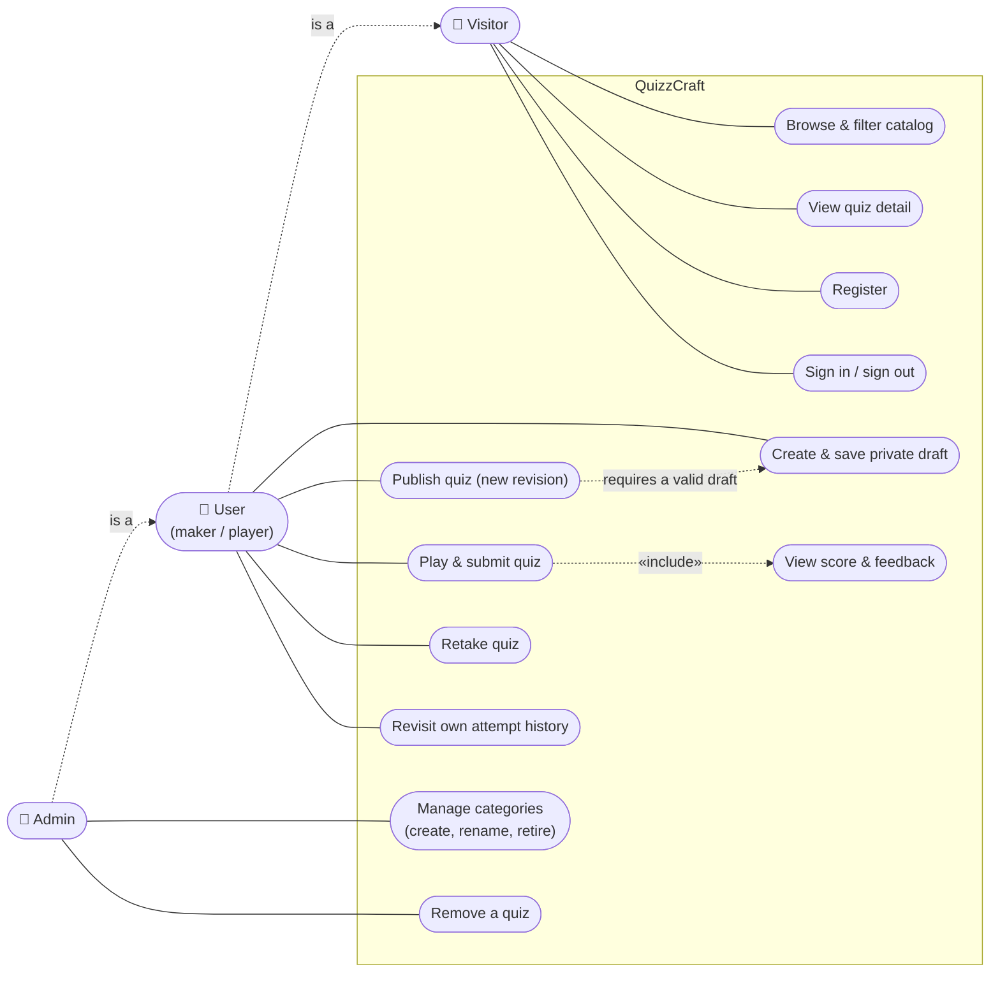
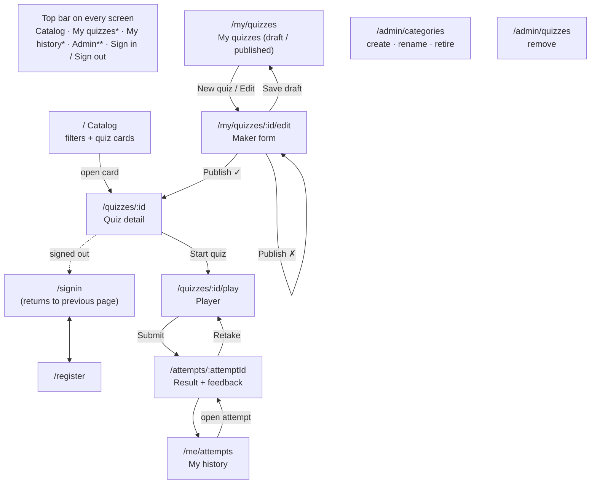

# QuizzCraft — Requirements, user journeys and test plan (QC-17)

Status: **DRAFT for team review** · Owner: Rim · Sprint 1 (Fri 27 Nov 2026)
Sources: team handoff ("The quiz rules"), `api-contract.md` on branch `QC-18-api-contract` (Ghadi), member ticket lists.
Requirement IDs reuse the prefixes already in use (`ENG-03`, `REV-01` in the API contract, `PLAY-01` in the handoff).

Contents: 1 Actors · 2 Use-case model · 3 User journeys · 4 Requirements · 5 Desktop navigation sketch · 6 Test plan · 7 Assumptions and open decisions

---

## 1. Actors

| Actor | Who | Inherits |
|---|---|---|
| Visitor | Anyone who is signed out | — |
| User (maker / player) | One regular account that can both make and play quizzes | Everything a Visitor can do |
| Admin | A seeded account with the `ADMIN` role. There is no route that grants it. | Everything a User can do |

## 2. Use-case model



Signed-out actors who try UC5–UC10 are sent to sign-in (ACC-03). A User who calls UC11–UC12 is denied (MOD-04).

## 3. User journeys

**J1 · Visitor finds a quiz.** The visitor opens QuizzCraft and sees the catalog of published quizzes. They pick a category, a difficulty and a format, and the list narrows. If nothing matches they see a clear message and a "Clear filters" button. They open a quiz's detail page. When they press "Start quiz" they are asked to sign in, because play requires an account in this release.

**J2 · Maker publishes a quiz.** The user signs in, opens *My quizzes* and creates a quiz. They enter a title, description, category and difficulty, then add multiple-choice and true/false questions, marking one correct choice for each. They save a private draft, leave, and reopen it later. If they try to publish an incomplete quiz, the form shows which fields are wrong. Once the quiz is valid they publish it, and it appears in the catalog immediately. Later they edit it and publish again. The earlier revision is preserved.

**J3 · Player plays, retakes and revisits.** The user opens a published quiz and plays it with no timer. They can skip questions and change or clear answers. On submission the server grades it and the user sees the score and per-question feedback. They retake it, which creates a separate attempt. Later they open *My history* and reopen the first attempt. It shows the original questions, answers and score, even after the maker republished, an admin removed the quiz, or the server restarted.

**J4 · Admin moderates.** The admin signs in and opens *Admin*. They create a category, rename one and retire another. Quizzes already in a retired category keep it and stay filterable, but new drafts cannot use it. The admin removes a quiz. It disappears from the catalog and direct public links, while players keep their past results.

**J5 · Denied paths (cross-cutting).** A signed-out visitor cannot create, play or read history. A user cannot edit someone else's quiz, read someone else's attempt or reach admin routes. These denials are checked at the API, not just hidden in the UI.

## 4. Requirements

Priority uses MoSCoW: **M** = must have for the 1 Dec release, **W** = won't have this release. "Sprint" is the sprint in which the requirement must first be demonstrated. "Check" is one observable test the team can run. "Test name / result" is filled in as tickets close (see §6.6).

### 4.1 Visit and filter (CAT)

| ID | Pri | Requirement | Check (observable) | Tickets | Sprint |
|---|---|---|---|---|---|
| CAT-01 | M | A visitor can browse published quizzes. Each card shows title, short description, category, difficulty and format. | Signed out, open the catalog. Every seeded published quiz is listed with all five fields. | QC-22, QC-23 | S1 |
| CAT-02 | M | Category, difficulty (Easy/Medium/Hard) and format (MC/TF) filters combine with AND. Clearing them restores the full list. | Select Science + Easy + True/False and the expected seeded titles appear (§6.4). Press "Clear filters" and all published quizzes return. | QC-22, QC-23 | S1 |
| CAT-03 | M | A mixed quiz matches either format filter and appears once. | `GET /api/quizzes?format=MULTIPLE_CHOICE` and `?format=TRUE_FALSE` each return "Planets Warm-Up" exactly once. | QC-22 | S1 |
| CAT-04 | M | An empty result shows a clear "no match" message. | Choose a combination with no seeded quiz. The API returns `200` with `items: []`, and the UI shows "No quizzes match these filters" with a "Clear filters" button. | QC-22, QC-23 | S1 |
| CAT-05 | M | Private drafts, never-published quizzes and removed quizzes never appear publicly. | The seeded draft's title is absent from every filter combination. `GET /api/quizzes/{draftQuizId}` returns `404`. | QC-20, QC-22 | S1 |

### 4.2 Register and sign in (ACC)

| ID | Pri | Requirement | Check (observable) | Tickets | Sprint |
|---|---|---|---|---|---|
| ACC-01 | M | A visitor can register one regular account that can both make and play quizzes. | Register `playerA`, sign out, sign in again. Registering the same email again returns `409 EMAIL_TAKEN` and the UI shows the message. | QC-21, QC-24 | S1 |
| ACC-02 | M | Invalid credentials are rejected without revealing which field was wrong. | A wrong password returns `401 INVALID_CREDENTIALS`, no token is stored, and the UI shows one generic error. | QC-21, QC-24 | S1 |
| ACC-03 | M | **Denied access, signed out:** creating, playing, submitting and reading history require sign-in. | Without a token, `POST /api/my/quizzes`, `GET /api/quizzes/101/play` and `GET /api/me/attempts` each return `401`. In the UI, "Start quiz" and "My history" lead to sign-in. | QC-21, QC-24 | S1 |
| ACC-04 | M | **Denied access, self-promotion:** registration never grants admin. | Register with `"role":"ADMIN"` in the body, then call `POST /api/admin/categories`. It returns `403`. | QC-21 | S1 |
| ACC-05 | M | **Restart persistence:** accounts survive a server restart. | Register `playerA`, restart Spring Boot (PostgreSQL keeps its data), and sign in successfully. | QC-19, QC-21 | S1 |

### 4.3 Make and publish (MAKE)

| ID | Pri | Requirement | Check (observable) | Tickets | Sprint |
|---|---|---|---|---|---|
| MAKE-01 | M | An owner can save a private draft with title, description, category, difficulty and questions, then reopen it. | Save a draft, sign out and back in, and reopen it with every field intact. Its title is absent from the catalog. | QC-27, QC-32 | S2 |
| MAKE-02 | M | Both single-answer multiple-choice and true/false questions are supported. | Create one question of each type. A TF question always has exactly the two choices True/False. | QC-27, QC-32 | S2 |
| MAKE-03 | M | Publication requires a title, an active category, a difficulty, at least one question and exactly one correct choice per question. | Publish a draft with no correct choice on question 2. The API returns `422` with `questions[1].choices`, and the form highlights that question. | QC-27, QC-32 | S2 |
| MAKE-04 | M | A valid quiz is published immediately. | Publish a valid draft. It appears in the catalog under its filters straight away. | QC-27, QC-32 | S2 |
| MAKE-05 | M | **Denied access, editing:** only the owner can edit or publish a quiz. | Signed in as `playerB`, `PUT /api/my/quizzes/{A's quiz}/draft` returns `403`. The UI offers no edit button on other users' quizzes. | QC-27, QC-32 | S2 |
| MAKE-06 | M | Republishing creates a new immutable revision. Earlier revisions are preserved, and the current publication stays playable while its owner edits a draft. | Publish rev 1, start a draft and keep playing rev 1, then publish rev 2. Rev 1's attempts still show rev 1's questions (see REV-01). | QC-27 | S2 |

### 4.4 Play and submit (PLAY)

| ID | Pri | Requirement | Check (observable) | Tickets | Sprint |
|---|---|---|---|---|---|
| PLAY-01 | M | The server grades each question 1 for correct and 0 for wrong or blank. | Submit correct + wrong + blank on "Planets Warm-Up" and the result is `1/3` (contract §5.3–5.4). | QC-25, QC-29 | S2 |
| PLAY-02 | M | **Hidden answers:** the playable response never contains the answer key. | Inspect `GET /api/quizzes/101/play` in the browser Network tab. There is no `isCorrect` or `correctChoiceId` anywhere in it. | QC-18, QC-29, QC-33 | S2 |
| PLAY-03 | M | Play is solo and untimed. The player can skip a question, change an answer and clear an answer before submitting. | Answer Q1, change it, clear Q2, skip Q3 and submit. The request body matches the final screen state. | QC-33 | S2 |
| PLAY-04 | M | The submission targets the revision that was shown. Invalid choices are rejected. | Submit to rev 1001 after rev 1002 exists and it is graded against 1001 (D1/D2). A `choiceId` from another question returns `422`. | QC-29 | S2 |
| PLAY-05 | M | The score and per-question feedback (chosen and correct answer) appear only after submission. | The result screen shows `1/3` with ✓/✗ per question and the correct choice. Before submission, no screen or response reveals it. | QC-29, QC-33 | S2 |
| PLAY-06 | M | If a quiz is removed while a player has it open, submission is rejected and no attempt is saved. | Open play, admin removes the quiz, then submit. The API returns `410 QUIZ_REMOVED`, the attempt count is unchanged, and the UI explains that the quiz was removed (D3). | QC-29, QC-35 | S3 |

### 4.5 Revisit attempts (REV)

| ID | Pri | Requirement | Check (observable) | Tickets | Sprint |
|---|---|---|---|---|---|
| REV-01 | M | An attempt keeps its original revision, questions, responses and score after the quiz is republished. | Attempt rev 1, publish rev 2 with a changed question, and reopen the attempt. It shows rev 1's text and the original score. | QC-18, QC-31, QC-33 | S2 |
| REV-02 | M | Retakes are unlimited and each creates a separate record. | Play the same quiz twice and *My history* lists two attempts with different IDs and their own scores. | QC-29, QC-31, QC-33 | S2 |
| REV-03 | M | **Denied access, history:** only the owner can read their attempts. | As `playerB`, `GET /api/attempts/{A's attemptId}` returns `403`. Signed out, it returns `401`. | QC-31, QC-33 | S2 |
| REV-04 | M | **Restart persistence:** history survives quiz removal and server restart. | Attempt, admin removes the quiz, restart the server, then reopen the attempt. It returns `200` with the original score, and history shows "Quiz removed" (D4). | QC-31, QC-35, QC-42 | S3 |

### 4.6 Moderate (MOD)

| ID | Pri | Requirement | Check (observable) | Tickets | Sprint |
|---|---|---|---|---|---|
| MOD-01 | M | An admin can create and rename categories. A rename shows everywhere, including history. | Create "History", rename it "World History", and the catalog filter and existing cards show the new name. | QC-34 | S3 |
| MOD-02 | M | An admin can retire a category. Existing publications keep it and stay filterable, and new assignments cannot use it. | Retire Science. Filtering by Science still returns "Planets Warm-Up". Publishing a draft with Science returns `422 Category is retired` (D5). | QC-34 | S3 |
| MOD-03 | M | An admin can remove a quiz. It is hidden from the catalog and from direct public detail and play, and earlier history is preserved. | Remove the quiz. It is absent from the catalog, and `/api/quizzes/{id}` and `/play` return `404` (D6). The owner's attempt still opens (REV-04). | QC-35 | S3 |
| MOD-04 | M | **Denied access, admin:** a regular user's admin requests are refused. | As `playerA`, `DELETE /api/admin/quizzes/101` and `POST /api/admin/categories` return `403`. The *Admin* menu is not shown. | QC-34, QC-35 | S3 |

### 4.7 Engineering and release (ENG)

| ID | Pri | Requirement | Check (observable) | Tickets | Sprint |
|---|---|---|---|---|---|
| ENG-01 | M | The app runs locally (React, Spring Boot and PostgreSQL) by following the README. | Follow the README commands exactly. React shows a database-backed response. | QC-19 | S1 |
| ENG-02 | M | Original seed data loads on a fresh database. | Run the seed on an empty database and the §6.4 titles exist. | QC-20 | S1 |
| ENG-03 | M | The browser only calls the API. The server enforces permissions, validates publication and grades. | Every denial and validation check above passes when called with `curl`, bypassing the UI. | QC-18 | S1 |
| ENG-04 | M | A clean clone with a fresh database passes the full demo and regression suite. | QC-42 run at a named commit. Results are recorded in §6.6. | QC-42 | S3 |

### 4.8 Out of scope for this release (W)

QC-43 title search, QC-44 newest-first sort, QC-45 favorites, QC-46 ratings/comments, anonymous play (decided: sign-in required), typed answers, multiplayer, mobile, product-side AI, Docker and public hosting.

## 5. Desktop navigation sketch

### 5.1 Screen map

The route paths are a proposal for the React app (see §7).



\* signed-in only · \*\* admin only. A signed-out visitor who opens a protected route is redirected to `/signin`. A user who opens `/admin/*` sees "Not allowed" (the API also returns `403`).

### 5.2 Key screens (desktop, ≥1280 px)

```
┌──────────────────────────────────────────────────────────────────────────────┐
│ QuizzCraft      Catalog   My quizzes   My history   Admin        Rim ▾ Sign out│
├───────────────────┬──────────────────────────────────────────────────────────┤
│ FILTERS           │  3 quizzes                                               │
│ Category  [All ▾] │  ┌──────────────────┐ ┌──────────────────┐ ┌───────────┐ │
│ Difficulty        │  │ Planets Warm-Up  │ │ ...              │ │ ...       │ │
│  ○Easy ○Med ○Hard │  │ Three quick q... │ │                  │ │           │ │
│ Format            │  │ Science · Easy   │ │                  │ │           │ │
│  ☐ Multiple choice│  │ Mixed · 3 q      │ │                  │ │           │ │
│  ☐ True / false   │  └──────────────────┘ └──────────────────┘ └───────────┘ │
│ [Clear filters]   │  Empty state: "No quizzes match these filters." [Clear]  │
└───────────────────┴──────────────────────────────────────────────────────────┘

PLAYER  /quizzes/101/play                       RESULT  /attempts/7001
┌──────────────────────────────────────────┐   ┌──────────────────────────────┐
│ Planets Warm-Up        Q 2 of 3  (no timer)│   │ Planets Warm-Up    Score 1/3 │
│ Jupiter is a rocky planet.               │   │ ✓ Q1 Mercury                 │
│  ○ True   ○ False          [Clear answer] │   │ ✗ Q2 You: True · Correct: False│
│ [◀ Prev] [Skip ▶]   ● ○ ○ jump to question│   │ ✗ Q3 Blank · Correct: 8       │
│                       [Submit quiz]      │   │ [Retake]   [My history]      │
└──────────────────────────────────────────┘   └──────────────────────────────┘
```

Submit asks for confirmation if any question is blank ("2 of 3 answered — submit anyway?").

## 6. Test plan

### 6.1 Scope

In scope: every **M** requirement in §4, on desktop Chrome or Edge against local React, Spring Boot and PostgreSQL. Out of scope: §4.8, mobile layouts, load testing and hosted deployment.

### 6.2 Test levels and responsibilities

| Level | What it proves | Tooling | Owner | Requirements |
|---|---|---|---|---|
| Unit | Grading rules, publication validation, format derivation | JUnit 5 (Spring Boot) | Hady (grading QC-29), Bilal (validation QC-27) | PLAY-01, PLAY-04, MAKE-03, CAT-03 |
| API + PostgreSQL integration | Status codes, access rules, filters, persistence, revisions | Spring Boot test against a real PostgreSQL (setup from QC-19) | Bilal (catalog/publish/admin), Hady (auth/removal), Ghadi (history) | CAT-*, ACC-*, MAKE-05/06, PLAY-02/06, REV-*, MOD-* |
| UI acceptance | Each journey works end to end in the browser | Manual scripts UAT-1…UAT-5 (§6.5), with screenshots or a short screen recording | Rim (catalog, maker, player), Ghadi (sign-in QC-24), Bilal and Hady (admin) | All journeys |
| Quality | Coverage, static analysis, mutation-style check | Per QC-30/38/40 | Ghadi | Supports ENG-04 |
| Release regression | Clean clone, fresh database, full demo and full suite | README commands only | Rim + team (QC-42) | ENG-01…04 + all UATs |

### 6.3 Test accounts

`playerA` and `playerB` are regular accounts registered during the test, and `admin` is the seeded admin. Dev-only passwords live in the seed or `.env.example`, never in Jira, prompts or this document.

### 6.4 Test data (from the QC-20 seed)

The seed is [`data.sql`](../backend/src/main/resources/data.sql), loaded on startup after `schema.sql`. Categories are 1 Geography, 2 Science and 3 Mathematics. The dev-only admin `admin@quizzcraft.local` (user 1) owns every seeded quiz.

| Seed item | Category | Difficulty | Format | Visibility |
|---|---|---|---|---|
| Planets Warm-Up (quiz 101, rev 1001) | Science | Easy | Mixed (2 MC + 1 TF) | Published |
| Rivers and Mountains (quiz 102, rev 902) | Geography | Medium | True/False (3) | Published |
| Fractions Challenge (quiz 103, rev 903) | Mathematics | Hard | Multiple choice (3) | Published |
| Moon Basics (quiz 104, draft rev 904) | Science | Easy | True/False (2) | Draft (must never appear) |

The draft would match Science + Easy + True/False if it leaked, so that filter also checks CAT-05. Seeded ids sit at or below the contract's example ids, so the next generated ids are quiz 105 and revision 1002.

Expected filter results, observed on a fresh database with [`qc-20-catalog-check.sql`](qc-20-catalog-check.sql) ([evidence](qc-20-evidence.md)):

| Filters | Expected titles |
|---|---|
| none | Planets Warm-Up, Rivers and Mountains, Fractions Challenge (3) |
| Science + Easy + True/False | Planets Warm-Up |
| format = Multiple choice | Planets Warm-Up, Fractions Challenge |
| format = True/False | Planets Warm-Up, Rivers and Mountains |
| Geography + Medium | Rivers and Mountains |
| Mathematics + Hard | Fractions Challenge |
| Science + Hard | *(empty → message)* |

### 6.5 User acceptance scripts

**UAT-1 Visitor (J1):** signed out → catalog shows all published quizzes → apply the three combined filters → check the expected titles → clear the filters → apply the empty combination → see the message → open detail → Start quiz → redirected to sign-in. *Covers CAT-01…05, ACC-03.*

**UAT-2 Accounts (J5):** register `playerA` → register the same email again (409) → wrong password (401) → sign in → restart the server → sign in again → register with `role:ADMIN` and call an admin route (403). *Covers ACC-01…05.*

**UAT-3 Maker (J2):** `playerA` creates a draft with 1 MC and 1 TF question → saves, signs out and in, reopens it → publishes with a missing correct choice (422 shown) → fixes and publishes → the quiz is in the catalog → `playerB` tries to edit it (403) → `playerA` edits and republishes (rev 2). *Covers MAKE-01…06.*

**UAT-4 Player (J3):** `playerB` plays "Planets Warm-Up" → Network tab shows no answer key → change, clear and skip answers → submit correct, wrong and blank → `1/3` with feedback → retake → history shows two attempts → `playerA` requests B's attempt (403) → after rev 2, B's first attempt still shows rev 1. *Covers PLAY-01…05, REV-01…03. Record the attempt IDs.*

**UAT-5 Admin (J4):** admin creates, renames and retires a category → retired category still filters → a draft using it cannot be published (422) → `playerB` opens play on a quiz → admin removes it → B submits (410) → catalog, detail and play return 404 → restart → B's earlier attempt reopens with "Quiz removed" → `playerA` calls admin routes (403). *Covers MOD-01…04, PLAY-06, REV-04.*

### 6.6 Entry and exit criteria

**Ticket entry:** the agreed example payload exists (contract §5) and the requirement IDs the ticket covers are listed on the Jira card.
**Ticket exit (Done):** every listed requirement's check was run and the observed result is pasted into Jira using the team template (Requirement · Change/PR · Check · Expected · Observed · Evidence · Effort · Review · Limitations). Scoring tickets also link the red and the green commit.
**Sprint exit:** that sprint's demo increment runs (S1 run + filter + sign-in · S2 publish + play + retake + original result · S3 moderation + preserved history + clean-clone demo), and its UATs pass on the current default branch.
**Release exit (QC-42, by Mon 30 Nov):** all **M** requirements pass on a clean clone with a fresh database at a named commit. The full automated suite is green. No open blocker remains. Remaining limitations are listed in the release notes.

### 6.7 Traceability matrix

Fill one row per requirement as evidence comes in. Example chain: `PLAY-01 → QC-29 → [commit/PR] → [test name] → [observed result]`.

| Req | Ticket | Commit / PR | Named test or UAT step | Observed result | Date |
|---|---|---|---|---|---|
| CAT-02 | QC-22, QC-23 | | UAT-1 step 3 | | |
| PLAY-01 | QC-29 | | | | |
| REV-04 | QC-31, QC-35 | | UAT-5 step 6 | | |
| … | | | | | |

## 7. Assumptions and open decisions

These need a team answer at the Sprint 1 review (record it on QC-12).

1. **Requirement IDs.** The prefixes CAT/ACC/MAKE/PLAY/REV/MOD/ENG were chosen to fit `ENG-03`, `REV-01` (QC-18) and `PLAY-01` (handoff). If Jira already defines other IDs, rename these to match.
2. **Seed titles.** Only "Planets Warm-Up" is known. §6.4 is completed once QC-20 is merged.
3. **Front-end routes** in §5 are proposed, not yet agreed with Bilal and Ghadi.
4. **Retake** starts the *latest* published revision, which may differ from the revision of the attempt being viewed. Confirm.
5. **Owner plays own quiz.** Assumed allowed, and the attempt is recorded like any other.
6. **Removed quiz in *My quizzes*.** Assumed listed as "Removed", read-only, with no republish. Confirm with Hady (QC-35).
7. **Description** is assumed optional for publication. The contract lists title, active category, difficulty, ≥1 question and one correct choice.
8. **MC choice count.** The contract does not say. Proposal: 2–6 choices per MC question, enforced at publication (422).
9. **Blank-answer confirmation** before submit (§5.2) is a UI convenience only. The server still accepts blanks and scores them 0.
10. **Token expiry and storage (QC-21).** The default lifetime is one hour. The QC-24 client should hold the token in React memory and prompt for sign-in on expiry or when a protected action follows a page reload.
